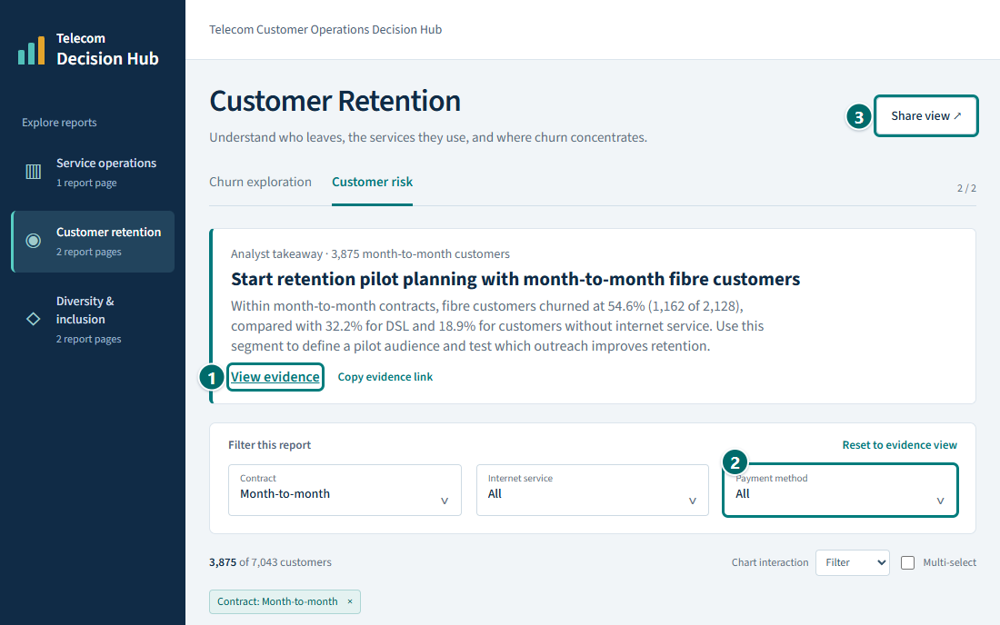

# Telecom Customer Operations Decision Hub

[](https://timkong21.github.io/telecom-customer-operations-decision-hub/)

An independent portfolio project that extends three Power BI tasks from the PwC Switzerland virtual case experience on Forage into a browser-based decision hub. Start with an analyst finding, inspect the evidence, then use filters and chart selections to answer your own questions. The Hub runs in the browser and requires no Power BI installation or sign-in.

<p align="center">
  
</p>

## Explore the case studies

| Case study | Decision it supports | Saved view | Source report |
| --- | --- | --- | --- |
| [Call Centre Trends](reports/Task%201%20-%20Call%20Centre%20Trends/README.md) | When should the call centre review staffing coverage? | [Hourly calls and unanswered calls](https://timkong21.github.io/telecom-customer-operations-decision-hub/#/calls/1?evidence=call-volume-peak) | [Original Power BI (.pbix)](reports/Task%201%20-%20Call%20Centre%20Trends/Call%20Centre%20Trends.pbix) |
| [Customer Retention](reports/Task%202%20-%20Customer%20Retention/README.md) | Which customer segment should a retention pilot target first? | [Month-to-month churn by internet service](https://timkong21.github.io/telecom-customer-operations-decision-hub/#/retention/2?evidence=churn-by-contract) | [Original Power BI (.pbix)](reports/Task%202%20-%20Customer%20Retention/Customer%20Churn%20and%20Risk%20Analysis.pbix) |
| [Diversity & Inclusion](reports/Task%203%20-%20Diversity%20%26%20Inclusion/README.md) | Where should HR investigate gaps in representation by job level? | [FY20 workforce by job level](https://timkong21.github.io/telecom-customer-operations-decision-hub/#/inclusion/1?evidence=fy20-leadership-representation) | [Original Power BI (.pbix)](reports/Task%203%20-%20Diversity%20%26%20Inclusion/Diversity%20%26%20Inclusion.pbix) |

Each case study includes the findings, recommendations, source workbook, and screenshots of every original Power BI page. Open the `.pbix` files in Power BI Desktop to explore the original reports.

The saved links require the interactive release on GitHub Pages. In a local preview, open the relevant report and choose **View evidence**.

## How to use the Hub

Try this in **Customer Retention**. The sidebar switches reports, and the tabs switch pages within a report.

<p align="center">
  
</p>

1. **Start with a finding.** On **Customer Risk**, choose **View evidence** from the takeaway. It opens the churn-by-internet-service chart and its data table with **Month-to-month** selected.
2. **Ask a follow-up.** Add a **Payment method** filter to narrow the cohort and see the charts and KPIs update. Select a chart category to filter related visuals, or use **Highlight** to keep the full comparison visible and emphasize the selection. Open **View data & select** for exact values and keyboard selection.
3. **Share the view.** **Share view** copies a link with your current filters and chart selections. **Copy evidence link** copies the analyst’s saved starting view. **Reset to evidence view** restores that view after exploration.

## Build and validation

The Hub is a static React and TypeScript site built with Vite and Apache ECharts. Python prepares the source workbooks into datasets that the browser filters and uses to update measures and visuals. The browser runs independently of Power BI Service.

### Run locally

Use **Node.js 22.12+**, npm, and **Python 3.10+**. Install the Python packages in a virtual environment outside the repository.

```bash
python -m pip install -r requirements.txt
npm ci
npm run analyze
npm test
npm run dev
```

Open the URL printed by Vite, including `/telecom-customer-operations-decision-hub/`. To check the production output, run `npm run build` and then `npm run preview`. Windows users with multiple Node installations can use `./scripts/dev.ps1` to select a compatible runtime on PATH.

### Verify and deploy

Data preparation checks the source workbooks and regenerates the reference fixtures. Tests compare report measures and chart series against independent calculations and check interaction and link behaviour. [Validation notes](docs/validation.md) · [Power BI calculations and web adaptations](docs/report-fidelity.md) · [Validation workflow](.github/workflows/check.yml)

GitHub Pages deployment runs manually through **Deploy GitHub Pages**. The workflow validates the data, runs tests, and publishes the static build. [Deployment workflow](.github/workflows/github-pages.yml)

## License and case materials

This independent portfolio project has no affiliation with or endorsement from PwC. The MIT license covers original code and documentation. The supplied workbooks, Power BI files, reference screenshots, and third-party marks are subject to their respective terms. [MIT License](LICENSE) · [Case-material notice](NOTICE.md)
