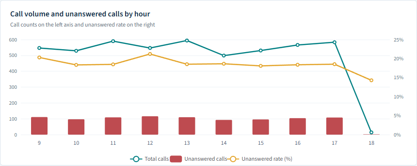

# Task 1 · Call Centre Trends

## Task brief

In the PwC Switzerland Power BI case experience on Forage, the call centre manager needed a dashboard to track customer satisfaction, calls answered and resolved, answer speed, and agent performance. The analysis covers **5,000 calls from January through March 2021**.

## Key findings and recommendations

### Review staffing coverage around noon

The 13:00 hour had the highest call volume, with **594 calls**. The 12:00 hour had the most unanswered calls, at **116 of 547 (21.2%)**, compared with **110 of 594 (18.5%)** at 13:00. Across the full sample, **946 of 5,000 calls (18.9%)** went unanswered.

  

Check whether the noon pattern holds across dates and topics, then compare it with agent coverage before changing shifts. If the gap recurs when coverage is thinner, trial a schedule adjustment and monitor the unanswered rate around noon and in adjacent hours.

[View hourly call volume and unanswered calls in the Decision Hub](https://timkong21.github.io/telecom-customer-operations-decision-hub/#/calls/1?evidence=call-volume-peak)

## Original Power BI report

[Source workbook](01%20Call-Center-Dataset.xlsx) · [Power BI report (.pbix)](Call%20Centre%20Trends.pbix)

Show original Power BI report (1 page)

**Page 1 · Call centre performance**

  

