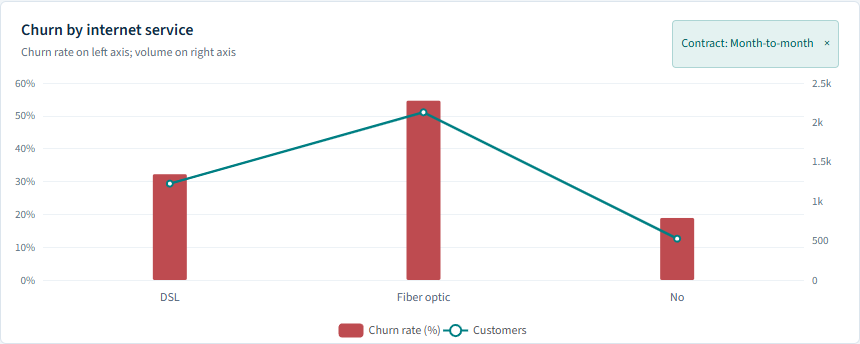

# Task 2 · Customer Retention

## Task brief

In the PwC Switzerland Power BI case experience on Forage, the telecom retention manager needed a dashboard to understand who was leaving and identify where to focus retention efforts. The analysis covers **7,043 customers**, of whom **1,869 (26.5%)** churned. The churn exploration page profiles customers who left. The customer risk page uses all customers to compare churn rates across groups.

## Key findings and recommendations

### Start with month-to-month fibre customers

Month-to-month customers accounted for **1,655 of 1,869 churned customers**. Their churn rate was **42.7%**, compared with **11.3%** for one-year contracts and **2.8%** for two-year contracts. Within the **3,875 month-to-month customers**, churn was highest among fibre customers at **54.6% (1,162 of 2,128)**, compared with **32.2%** for DSL and **18.9%** for customers without internet service. Each rate uses all customers in its own group as the denominator.

  

Use month-to-month fibre customers as the starting audience for a retention pilot. Compare outreach against a holdout group and measure whether it reduces churn. Use customer feedback and service history to investigate what drives the gap.

The saved view opens **Customer Risk** with **Month-to-month** selected and all internet service groups visible. [View churn by internet service in the Decision Hub](https://timkong21.github.io/telecom-customer-operations-decision-hub/#/retention/2?evidence=churn-by-contract)

## Original Power BI report

[Source workbook](02%20Churn-Dataset.xlsx) · [Power BI report (.pbix)](Customer%20Churn%20and%20Risk%20Analysis.pbix)

Show original Power BI report (2 pages)

**Page 1 · Churn exploration**

  

**Page 2 · Customer risk**

  

