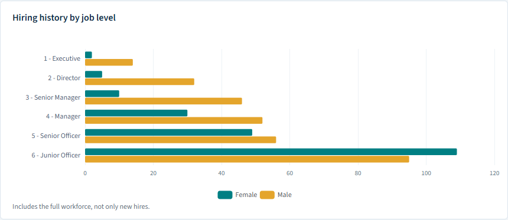

# Task 3 · Diversity & Inclusion

## Task brief

In the PwC Switzerland Power BI case experience on Forage, the HR team wanted to assess gender balance in executive management and understand where to look for barriers to progression. The analysis uses records for **500 employees** and examines workforce representation, hiring, promotions, turnover, and performance.

## Key findings and recommendations

### Review the path to senior roles

Women made up **41% of the FY20 workforce**. Representation varied by job level. Women held **109 of 204 junior officer roles (53.4%)**, **10 of 56 senior manager roles (17.9%)**, and **2 of 16 executive roles (12.5%)**. These figures describe who held each role in FY20. The executive group is small, so even one person makes a noticeable difference to the share.

  

*Women in FY20 roles: 109 of 204 junior officers, 10 of 56 senior managers, and 2 of 16 executives.*

Start the HR review by comparing promotion outcomes by gender within the pool of eligible employees at each level. Review hiring and departures alongside promotions to see where the representation gap emerges before deciding which action to take.

[View FY20 workforce representation by job level in the Decision Hub](https://timkong21.github.io/telecom-customer-operations-decision-hub/#/inclusion/1?evidence=fy20-leadership-representation)

## Original Power BI report

[Source workbook](03%20Diversity-Inclusion-Dataset.xlsx) · [Power BI report (.pbix)](Diversity%20%26%20Inclusion.pbix)

Show original Power BI report (2 pages)

**Page 1 · Hiring, promotions, and turnover**

  

**Page 2 · Performance, leadership, and age**

  

